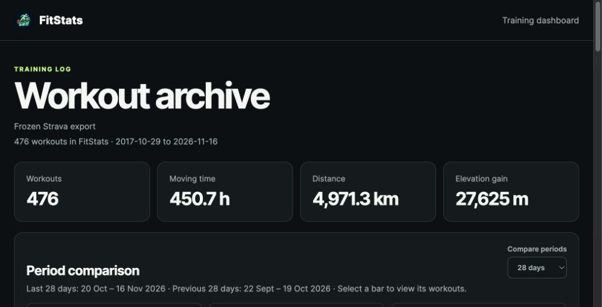

# FitStats

[**Open the live dashboard**](https://vgrox.github.io/FitStats/)

FitStats is a fitness analytics project built with SQL, SQLite, TypeScript, and JavaScript. The public dashboard explores **476 workouts** from a one-time Strava export.

## What I built

- Imported and deduplicated activity records in SQLite, then used SQL to prepare distance, moving time, pace, and speed for analysis.
- Built interactive charts and filters to compare training periods, explore activity types, and drill into individual workouts with GPS and heart-rate data where available.
- Published a static snapshot on GitHub Pages that visitors can open without a Strava account.

## Run it locally

The [setup guide](docs/setup.md) covers the synthetic demo, Strava export imports, local API sync and webhooks, and the database schema.
